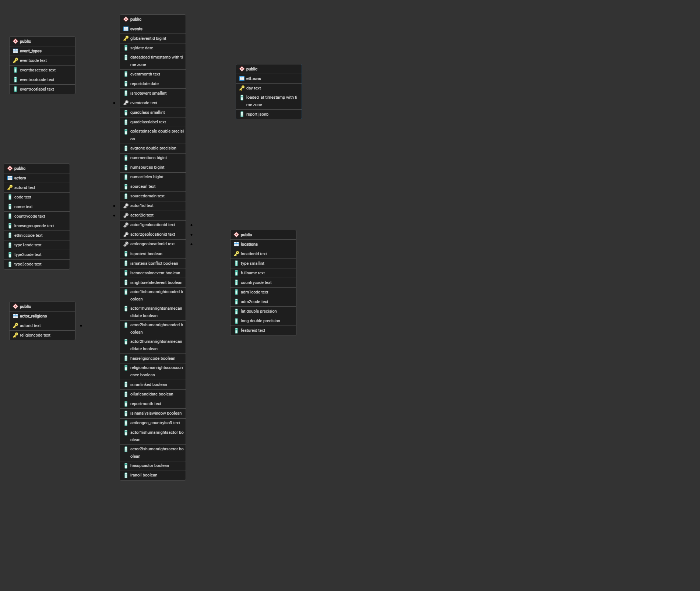

# DAEN 328 — GDELT Events Pipeline

## Dataset size and coverage

We use **GDELT 2.0 Events** to study news coverage of religion, human-rights
organizations, Iran and oil, and protests. The following snapshot was measured
from local CSV batches and daily transformation reports on November 16, 2026.

| Measure | Collected dataset |
| --- | --- |
| Event rows received by daily transformation | **17,963,639** |
| Event rows retained after cleaning | **17,963,639** |
| Raw fields per event | **61** |
| Timestamped archive batches | **17,664** |
| First / last collected archive (UTC) | **2026-05-15 06:45 / 2026-11-15 06:30** |
| Daily transformation reports | **185** |
| Duplicates removed / rows quarantined by daily transformation | **0 / 0** |
| Raw CSV storage | **7,417,505,011 bytes** (approximately **7.42 GB**) |
| Daily transformed CSV storage | **11,725,284,537 bytes** (approximately **11.73 GB**) |

Counts come from `data/transformed/YYYYMMDD/quality_report.json`; raw file counts
and sizes come from `data/batches/*.csv`. These describe collected files, rather
than a verified count of distinct records loaded into PostgreSQL. Dimension rows
can recur across daily exports; use the dashboard's **Data quality** tab for
database table counts. Storage figures exclude PostgreSQL, indexes, Docker images,
backups, and temporary files.

The collection covers six calendar months of **archive publication times**.
`SQLDATE` is the event date and can fall outside that publication window.
GDELT publishes Events archives every 15 minutes; see the
[official event codebook](https://data.gdeltproject.org/documentation/GDELT-Event_Codebook-V2.0.pdf).
Generated data is ignored by Git: cloning the repository does not copy the
dataset or a teammate's database.

### Raw field descriptions

Upstream ZIPs contain headerless, tab-separated records. `extract.py` assigns the
61 names in `EVENT_COLUMNS` and saves headed CSV batches. Codes are read as
strings to preserve leading zeros. Types below describe cleaned values;
PostgreSQL column names are lowercase.

| Field or group | Cleaned type | Description / use |
| --- | --- | --- |
| `GLOBALEVENTID` | `BIGINT` | Unique event key. |
| `SQLDATE` | `DATE` | Event day, parsed from `YYYYMMDD`; used by dashboard date filters. |
| `MonthYear`, `Year`, `FractionDate` | Raw calendar fields | Redundant date representations; omitted from the normalized event table. |
| `DATEADDED` | `TIMESTAMPTZ` | UTC recording timestamp, parsed from `YYYYMMDDHHMMSS`; used to compare record versions. |
| `Actor{1,2}Code`, `Actor{1,2}Name` | `TEXT` | Actor codes and names. Actor 1 performs the action involving actor 2. |
| `Actor{1,2}CountryCode`, `KnownGroupCode`, `EthnicCode` | `TEXT` | Country affiliation, group, and ethnicity attributes for each actor. |
| `Actor{1,2}Religion1Code`, `Religion2Code` | `TEXT` | Religion attributes, stored in the `actor_religions` bridge. |
| `Actor{1,2}Type1Code`, `Type2Code`, `Type3Code` | `TEXT` | Up to three role codes for each actor. |
| `IsRootEvent` | `SMALLINT` | Lead-sentence event indicator, `0` or `1`. |
| `EventCode`, `EventBaseCode`, `EventRootCode` | `TEXT` | Detailed CAMEO action code and parent categories. |
| `QuadClass` | `SMALLINT` | 1: verbal cooperation; 2: material cooperation; 3: verbal conflict; 4: material conflict. |
| `GoldsteinScale` | `DOUBLE PRECISION` | Event-type conflict/cooperation score, −10 to +10. |
| `NumMentions`, `NumSources`, `NumArticles` | `BIGINT` | GDELT coverage counts; nonnegative integers. |
| `AvgTone` | `DOUBLE PRECISION` | News tone score, −100 to +100. |
| `{Actor1Geo,Actor2Geo,ActionGeo}_Type` | `SMALLINT` | Geographic match type; type 0 produces no location reference. |
| `{Actor1Geo,Actor2Geo,ActionGeo}_FullName` | `TEXT` | Matched location name. |
| `{Actor1Geo,Actor2Geo,ActionGeo}_CountryCode` | `TEXT` | Geographic country code, distinct from actor affiliation coding. |
| `{Actor1Geo,Actor2Geo,ActionGeo}_ADM1Code`, `_ADM2Code` | `TEXT` | Administrative subdivision codes. |
| `{Actor1Geo,Actor2Geo,ActionGeo}_Lat`, `_Long` | `DOUBLE PRECISION` | Coordinates, validated against geographic bounds. |
| `{Actor1Geo,Actor2Geo,ActionGeo}_FeatureID` | `TEXT` | Geographic feature identifier. |
| `SOURCEURL` | `TEXT` | Source article URL. |

Actor groups repeat for actors 1 and 2; geographic groups repeat for both actors
and the action location. The complete list is in [extract.py](extract.py), and
source semantics are in the [GDELT codebook](https://data.gdeltproject.org/documentation/GDELT-Event_Codebook-V2.0.pdf).

### Derived analysis fields

| Fields | Definition / purpose |
| --- | --- |
| `EventMonth`, `ReportDate`, `ReportMonth` | Calendar groupings derived from the event date or UTC recording timestamp. |
| `IsInAnalysisWindow` | Inclusive event-date bounds supplied to transformation; NULL without bounds. Flags rows without removing them. |
| `ActionGeo_CountryISO3`, `SourceDomain` | Mapped action-country code and normalized HTTP(S) source hostname. |
| `QuadClassLabel`, `EventRootLabel` | Readable category labels; root labels are stored in `event_types`. |
| `IsProtest`, `IsMaterialConflict`, `IsConcessionEvent` | Root code 14, quad class 4, and root code 08, respectively. |
| `IsRightsRelatedEvent` | Membership in the explicit `RIGHTS_EVENT_CODES` selection in `transform.py`. |
| `Actor{1,2}IsHumanRightsCoded`, `Actor{1,2}IsHumanRightsActor` | Raw HRI role match and a stricter match excluding specified government roles. |
| `Actor{1,2}HumanRightsNameCandidate` | Human-rights organization keyword match on actor names. |
| `HasReligionCode`, `ReligionHumanRightsCooccurrence` | Any actor religion code; religion-coded actor paired with a qualifying human-rights actor. |
| `IsIranLinked`, `OilURLCandidate`, `IranOil`, `HasOPCActor` | Iran actor/location link, selected oil words in URL path/query, their conjunction, and OPC group-code match. |
| Actor/location foreign keys | Stable references to normalized profiles. |

Topic flags are code and keyword heuristics that identify candidates for review.
They do not establish causation, confirmed topics, or comprehensive coverage.

## Project overview and API

This four-person project extracts public news-derived event data with
`requests`, cleans it with pandas, loads related PostgreSQL tables using
psycopg2, and queries the database through SQLAlchemy in a Streamlit/Plotly
dashboard. Docker Compose coordinates the database, ETL job, and dashboard.

The source is the [GDELT Project](https://www.gdeltproject.org/data.html). Our
implementation uses its public archive feed without an API key:

| Endpoint | Purpose |
| --- | --- |
| [lastupdate.txt](https://data.gdeltproject.org/gdeltv2/lastupdate.txt) | Locate the newest Events archive. |
| [masterfilelist.txt](https://data.gdeltproject.org/gdeltv2/masterfilelist.txt) | Enumerate archive URLs, compressed sizes, and published MD5 checksums. |
| `https://data.gdeltproject.org/gdeltv2/YYYYMMDDHHMMSS.export.CSV.zip` | Download one Events batch. |

The timestamped index supplies archive selection instead of page-number
pagination. Events are the production dataset. Optional Mentions extraction and
sample validation exist, but the current loader does not create a Mentions table.
Keep `INCLUDE_MENTIONS=false` for the documented pipeline.

## Research questions and dashboard scope

The team's Phase 1 questions guide the analysis:

| Question | Intended analysis |
| --- | --- |
| 1. Correlation between religions and human-rights organizations | Most-mentioned religions and organizations; most frequent religion/organization pairs. |
| 2a. Compare the volume and themes of coverage involving major religions | Religion coverage and average tone over time; top five event types involving religion. |
| 2b. Distinguish religious reporting from rights-violation coverage | Separate general religious coverage from rights-related candidates and compare trends; the final operational definition remains to be agreed. |
| 3. Compare how the Iran Oil Crisis affects countries | Countries interacting most with Iran and the cooperation/conflict patterns of those interactions. |
| 4a. Where are protests associated with escalation? | Average Goldstein score by country for protest reports, alongside subsequent higher-impact events. |
| 4b. Where are protests associated with change? | Common subsequent responses, such as concessions, arrests, and force. |

**Dashboard work is ongoing.** Current views provide event/tone/Goldstein trends,
topic flags, countries, maps, sources, and quality reports. Religion and
organization rankings/pairs, religion-specific trends, Iran partner-country
comparisons, and protest-response sequences are not yet dedicated views in the
current `streamlit_app.py`. Alejandro and Tony are working on the dashboards.

Cooccurrence counts alone do not establish correlation. Average Goldstein scores
for protest-coded reports do not establish that protests caused later escalation
or change. The response questions require explicit event-linking/time-window
rules; country/location links also do not directly measure economic oil impacts.

## PostgreSQL schema and ERD

`load.py` automatically creates the tables, primary/foreign keys, and indexes.
Actor and location descriptors are separated from event facts, event taxonomy
has its own table, and religion memberships use a bridge.

| Table | Primary key | Contents and relationships |
| --- | --- | --- |
| `events` | `globaleventid` | 40 columns: dates, measures, source information, flags, and references to one event type, two actors, and three location roles. |
| `event_types` | `eventcode` | 4 columns: detailed/base/root codes and root label. Referenced by `events.eventcode`. |
| `actors` | `actorid` | 9 columns: profile ID, code, name, country, group, ethnicity, and three roles. Referenced by `events.actor1id` and `events.actor2id`. |
| `locations` | `locationid` | 9 columns: profile ID, geographic type/name, country/subdivisions, coordinates, and feature ID. Referenced by `actor1geolocationid`, `actor2geolocationid`, and `actiongeolocationid` in `events`. |
| `actor_religions` | `(actorid, religioncode)` | Religion memberships; `actorid` references `actors`. |
| `etl_runs` | `day` | Independent load audit: folder/day, successful load time, and JSONB transformation report. |

Actor and location IDs are SHA-256 hashes of normalized descriptors, so identical
profiles receive the same key across batches. Missing optional attributes and
references remain NULL. Dates use `DATE`, recording times `TIMESTAMPTZ`, counts
`BIGINT`, measures `DOUBLE PRECISION`, flags `BOOLEAN`, and codes `TEXT`.
Event indexes cover date, type, action location, and both actor references.


### Final ERD


Decision Context:
The design is a **star schema**: `events` is the fact table, surrounded by the dimension tables
`actors`, `locations` and `event_types`. `actor_religions` is a bridge table for the
many-to-many relationship between actors and religions, and `etl_runs` is a standalone audit log.


## Run the complete stack

Prerequisites: Git, Docker Desktop (or Docker Engine with Compose), internet
access to GDELT, and enough disk space for CSVs and PostgreSQL. The measured CSV
footprint is approximately 19.14 GB before database storage. Initial collection
of six months can take a long time.

1. Clone the repository and enter its directory:

   ```sh
   git clone https://github.com/RedRojoaka/DAEN_328_GDELT_Project.git
   cd DAEN_328_GDELT_Project
   ```

2. Copy the configuration template:

   ```sh
   cp .env.sample .env
   ```

   Edit `.env` and set `POSTGRES_PASSWORD` to a unique local password. Keep
   `POSTGRES_DB=gdelt`, `POSTGRES_USER=gdelt`, `POSTGRES_HOST=db`,
   `POSTGRES_PORT=5432`, and `INCLUDE_MENTIONS=false` for Compose.
   `.env` is ignored by Git. Compose enforces the internal database host/port
   for Python services.

   `LOOKBACK_MONTHS=6` selects six calendar months in UTC. An explicit
   `LOOKBACK_DAYS` overrides it for shorter tests; remove old day overrides for
   the full collection. Optional `EXTRACT_START` / `EXTRACT_END` set fixed
   `YYYYMMDDHHMMSS` archive boundaries: start exclusive, end inclusive.
   Leave both blank for rolling collection through the newest archive.

3. Start the full stack with the assignment's command:

   ```sh
   docker-compose up --build
   ```

   The equivalent Compose v2 spelling is `docker compose up --build`.
   PostgreSQL starts first; after its health check, ETL runs extraction,
   transformation, and loading in order. The dashboard starts after ETL exits
   successfully. No manual database creation or ETL trigger is needed.

4. Open the dashboard after loading completes:

   | Service | Address / behavior |
   | --- | --- |
   | Streamlit | [http://localhost:8501](http://localhost:8501); change `DASHBOARD_PORT` in `.env` if occupied. |
   | PostgreSQL | `localhost:5433` for host tools such as pgAdmin; database/user/password come from `.env`. Within Compose: `db:5432`. |
   | ETL | Batch job, logs in its container, exits with code 0 on success; no browser endpoint. |

Stop while preserving the named `postgres_data` database volume:

```sh
docker-compose down
```

Run `docker-compose up --build` again to rerun the pipeline. Avoid `down -v`
unless intentionally deleting the database. Changing `.env` credentials does not
change credentials already initialized in an existing database volume.

`ETL_WORK_DIR` is included in the sample but currently unused by the scripts.
See [docs/DOCKER.md](docs/DOCKER.md) for additional Docker/dependency notes;
the startup sequence above reflects the current application.

## Incremental pulls and duplicate prevention

Archive timestamps identify batches; `GLOBALEVENTID` identifies records.
`get_lastupdate_timestamp()` finds the newest upstream batch, rather than the
last locally loaded file. `get_starting_timestamp()` selects an explicit boundary
or the configured lookback; `saved_timestamps()` lists completed local CSVs.

Extraction selects timestamps in `(start, end]`, reuses completed batches, and
downloads missing archives inside the window, including gaps before newer cached
files. CLI `--start` / `--end` override the environment boundaries. Downloads
use retries/backoff and published MD5 checks; malformed records are quarantined.
Network failures or logged archive gaps stop extraction and prevent the next ETL
script from running. Investigate `data/skipped_events.txt` before retrying:
logged archive failures block progress.

Transformation deduplicates event IDs within each reporting-day batch, keeping
the latest `DATEADDED` and the last input row on a tie. Loading uses staging
tables, `COPY`, and primary-key conflict handling. Events update only when the
incoming recording timestamp is newer or the stored timestamp is NULL; existing
dimension keys are left unchanged. Each day's load is transactional, and primary
keys prevent duplicate database rows.

### Progress storage and current restart limitation

PostgreSQL's `etl_runs` stores successful load days, `loaded_at`, and quality
reports. **Extraction does not currently read a database checkpoint.** Its cache
is the timestamped files in `data/batches/`; transformation and loading revisit
available daily exports.

The default Compose file persists PostgreSQL but does not mount `data/`.
Removing containers with `down` loses their raw-file cache, so a fresh ETL
container can download the configured lookback again while database keys prevent
duplicate rows. The assignment's requirement to resume extraction from the last
successful position stored in PostgreSQL still needs implementation.
`etl_runs` is a load audit, not an implemented extraction checkpoint.

## Cleaning and data quality

Separate functions in `transform.py` normalize missing values/text, parse dates,
convert numbers, standardize event codes, quarantine invalid rows, deduplicate,
and derive analysis features. Missing-value handling is explicit:

| Fields / condition | Handling |
| --- | --- |
| Blank strings and explicit `null`, `none`, `nan`, `n/a` tokens | Normalize to NULL; preserve the valid code `NA`. |
| Missing/invalid `GLOBALEVENTID` or `SQLDATE` | Quarantine the row with original values and a reason. |
| Optional actor, location, URL, count, score, and recording-date fields | Retain missing values as NULL; invalid typed dates/numbers also become NULL. Do not invent values or zero counts. |
| Out-of-range numbers | Set the invalid value to NULL. |
| `EventCode` | Preserve leading zeros and validate structure; full CAMEO dictionary membership is not checked. |
| `EventBaseCode`, `EventRootCode` | Derive from the validated full code. |
| Unmapped action countries / geographic type 0 | Keep ISO3 NULL / omit the unmatched location reference. |

The measured daily reports record 8 invalid full event codes, with corresponding
invalid base/root values, and 1 invalid action longitude set to NULL. Missing
optional values were retained, including 7,865,626 actor-1 country values,
10,057,851 actor-2 country values, and 507,266 action latitudes. Zero quarantines
in these transformation reports does not establish zero malformed upstream rows.

Extraction prints received, malformed, cached, and ready row counts.
Transformation prints input/cleaned rows, duplicates, quarantines, and per-column
missing/invalid/derived counts. Loading prints rows read and **combined
inserted/updated** counts per table; separate insert and update totals required
by the assignment are not yet reported. Daily `quality_report.json` and
`rejected_events.csv` preserve evidence; successful load reports also appear in
PostgreSQL and the dashboard.

### Tests and logs

Run the assignment's test command:

```sh
docker-compose run --rm etl pytest
```

Run unit tests without starting PostgreSQL:

```sh
docker compose build etl
docker compose run --rm --no-deps etl python -m pytest -q
```

Tests use hand-built records and mocked HTTP responses. They cover cleaning,
missing-value policies, code preservation, stable keys/relationships, daily
batching, extraction windows/cache behavior, failure handling, and sample
validation. They do not prove a full six-month Docker run or database-driven
incremental restart. [tests/README.md](tests/README.md) describes optional real
GDELT sample validation.

```sh
docker compose logs --tail=100 etl
docker compose run --rm etl python scripts/docker_smoke.py
```

The second command checks packages, permissions, and database connectivity;
it does not validate the complete extraction or dashboard.

## Dashboard

The app reads PostgreSQL through SQLAlchemy and offers event-date, action-country,
and topic filters. Multiple selected topic flags combine with AND. The default
date range is the latest 30 days in the loaded data. Analytical filters use bound
SQL parameters.

| Tab | Current views |
| --- | --- |
| Overview | Daily event volume, average tone, average Goldstein score, quad-class counts. |
| Topics | Daily flagged-event counts and leading CAMEO root categories; the category query joins `events` and `event_types`. |
| Geography | Leading action countries and a map of up to 1,000 places, joining `events` and `locations`. |
| Sources & events | Source-domain rankings and a most-covered-events table joining event types and locations. |
| Data quality | Whole-database table counts and quality reports for loaded days. |

Coverage counts reflect news reporting and GDELT coding, rather than independent
counts of all real-world events. See the research-question table for planned
dashboard additions.

### Dashboard screenshot

**Pending actual screenshot:** capture the running dashboard with visible charts
and filters, save it as `docs/images/dashboard.png`, and embed it below before
submission.

<!-- Enable after a real dashboard screenshot is supplied:

-->

## Six-month CSV collection in Docker

This workflow preserves raw CSVs and daily exports on the host for inspection and
retrying. It does not load PostgreSQL or launch the dashboard. With Docker
running and `.env` configured:

```sh
docker compose build etl
docker compose run --rm --no-deps etl python -m pytest -q
```

For repeatable collection, set fixed UTC boundaries in `.env`. For example,
`EXTRACT_START=20260515000000` and `EXTRACT_END=20261115000000` span six calendar
months; these example boundaries differ from the measured snapshot above.
Keep the boundaries unchanged when retrying the same collection.

Preview the archive count, cache, and compressed download estimate:

```sh
docker compose run --rm --no-deps \
  --volume "$PWD/data:/app/data" \
  etl python extract.py --dry-run
```

The preview reads the index without downloading/saving archives. Compressed
traffic estimates do not include the larger extracted CSV footprint.
Download and transform one reporting day at a time:

```sh
docker compose run --rm --no-deps \
  --user "$(id -u):$(id -g)" \
  --volume "$PWD/data:/app/data" \
  etl sh -c 'python extract.py && python transform.py'
```

Raw batches remain in `data/batches/`; normalized tables, rejected rows, and
quality reports go to `data/transformed/YYYYMMDD/`. This bind mount preserves the
cache for retries. The UID/GID option is intended for macOS/Linux or WSL shells.
Building images and running unit tests do not start a full download.

Rerun transformation without downloading again:

```sh
docker compose run --rm --no-deps \
  --user "$(id -u):$(id -g)" \
  --volume "$PWD/data:/app/data" \
  etl python transform.py
```

## Repository guide

| Path | Responsibility |
| --- | --- |
| `extract.py` | Index selection, HTTP downloads, validation, timestamped raw batches. |
| `transform.py` | Cleaning, features, normalized daily CSVs, quality reports. |
| `load.py` | Schema creation, transactions, conflict handling, load audit. |
| `streamlit_app.py` | Database-backed charts, filters, quality views. |
| `tests/`, `scripts/` | Unit tests, Docker connection check, GDELT sample validation. |
| `Dockerfile`, `docker-compose.yml` | Python image and database/ETL/dashboard services. |
| `requirements.in`, `requirements.txt` | Direct dependencies and pinned packages. |
| `.env.sample` | Configuration template without secrets. |
| `data/` | Local generated files, excluded from Git and Docker builds. |

## Group members and contributions

| Member | Contribution |
| --- | --- |
| Maya Brumbalow | Extraction implementation, building presentation, transformation changes, dashboard planning. |
| Peyton Kocher | Daily GDELT processing, validation tests, Docker setup, infrastructure checks. |
| Tony (Anastacio) Moreno | PostgreSQL loading, pgAdmin schema/ERD, and dashboard development. |
| Alejandro Rojo | Transformation, repository integration/documentation, and dashboard development. |

Before finalizing, add Tony's ERD and a real dashboard screenshot, and update
the dashboard scope and rerun documentation as the remaining implementation lands.
